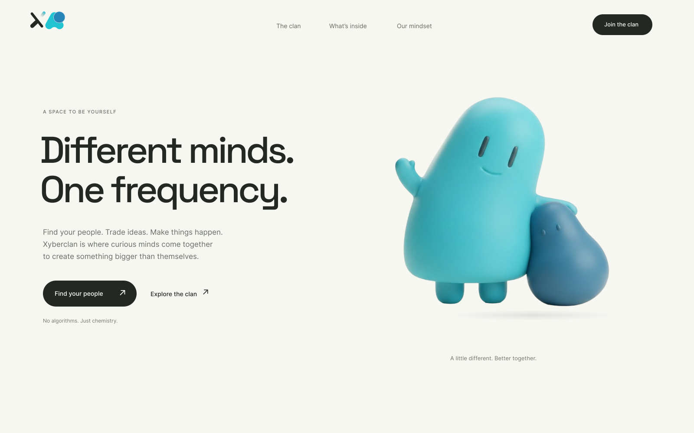

# Xyberclan — Community Website

**Different minds. One frequency.** The home of the Xyberclan community on the web, designed and built by its own members.



## Run it

```bash
pnpm i
pnpm dev
pnpm build
```

Node 22 LTS (see `.nvmrc`), pnpm only (`npm install` is blocked on purpose). Other scripts: `pnpm lint`, `pnpm format`, `pnpm typecheck`.

## Read first

- [PRODUCT.md](PRODUCT.md) — the real facts about the clan. Every fact on the site comes from there.
- [Creative direction](docs/creative-direction.md) — the idea, colours, type, motion and house rules.
- [Ticket board](tickets/README.md) — 59 tickets in build order, one file / one issue / one PR.
- [Team plan](docs/team-plan.md) — 7 developers, 7 lanes, 6 sprints.
- [CONTRIBUTING.md](CONTRIBUTING.md) — how to pick a ticket and open a PR (XYB-004, to be written).

Until CONTRIBUTING.md lands: take the next ticket in your lane whose dependencies are merged, say "I'm on it" on its issue, and build it.

The site is **bilingual, English and French, from day one** (XYB-006). Every PR shows both languages.

## The plan in one line per phase

| Phase             | What it builds                                                                         |
| ----------------- | -------------------------------------------------------------------------------------- |
| 0 — Foundations   | The repo, CI, previews, English + French routing, content schemas, contribution rules  |
| 1 — Brand system  | Logo, colour, type, layout, components, the 2D Blob characters                         |
| 2 — Motion engine | The clan beat, smooth scroll, text reveals, page transitions, the blob renderer        |
| 3 — Home          | Every home section, each with one job                                                  |
| 4 — Pages         | The Clan, What's inside, Our mindset, Events, Built, Journal, Join + Blob Maker        |
| 5 — Platform      | Discord, join backend, add-yourself-by-PR, share images, SEO, analytics, French review |
| 6 — Launch        | Accessibility, performance, device QA, launch checklist, showcase kit                  |
