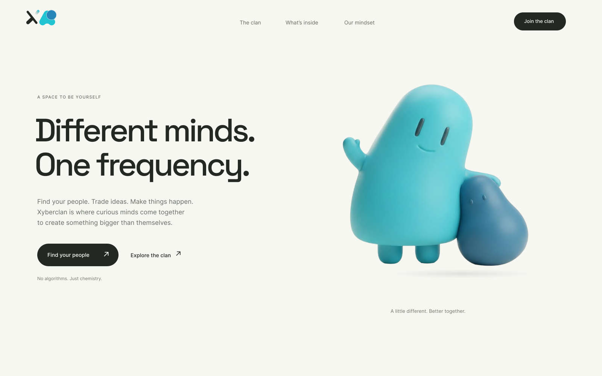

# Xyberclan — Creative Direction

> Read this before you pick up any ticket. Every ticket points back here.
> It is the "why" behind every colour, every word and every movement on the site.

---

## 1. The one idea

**Different minds. One frequency.**

On this site, **every member becomes a blob** — a small clay character with its own shape and colour —
and **the frequency becomes the beat that brings them into sync**.

That one sentence decides everything:

| The idea | What it becomes on the site |
| --- | --- |
| *Different minds* | Blobs are never identical. Different shapes ("species"), different colours, different expressions. A member picks theirs. |
| *One frequency* | The whole site moves on **one shared clock** (the clan beat). Every idle blob breathes, blinks and bobs on that same beat, on every page. |
| *Find your people* | The members wall, where blobs gather. You can hover any blob and meet the human behind it. |
| *Make things happen* | Real projects, real events, real photos. Never stock, never invented. |
| *No algorithms. Just chemistry.* | No feeds, no infinite scroll, no "recommended for you". People choose people. |

**The story the scroll tells:** the home page starts with two blobs. As you scroll, more appear,
each one moving out of phase. In the signature scene they slowly fall **into phase**, until they bob
together. The tagline is acted out, not just written.

**The live thing:** the **Blob Maker**. Anyone can make their own blob (shape, colour, face, craft)
and see it join the clan straight away. It is teased on the home page and lives in full on `/join`.
New members use it to make their avatar. (Tickets XYB-040, XYB-058.)

**The competitor test:** if you can swap "Xyberclan" for another community's name and the section
still works, the section is not finished. Every section must carry the blobs, the beat, or the
clan's own real content.

---

## 2. Visual system (starting point — finalised in XYB-010 → XYB-013)

### Colour (taken from the hero concept)

| Role | Value | Use |
| --- | --- | --- |
| Ground | `#F7F7F2` (paper) | Page background. |
| Ink | `#232823` | All running text, the primary button, the wordmark. Running text is always full ink, never soft grey. |
| Lagoon | `#22C4D2` | The big blob. A full-field section colour. Focus rings. |
| Deep | `#2785B7` | The small blob. A full-field section colour. |
| Blob colours | 4–6 more (XYB-011) | Only on blobs and on full-field sections. Never on small UI chrome. |

One ground, one ink, colour lives in the **characters** and in **whole fields** (a section may turn
fully Lagoon or Deep). Nothing fades into anything: no gradients.

### Type

- **Display:** the rounded geometric grotesk from the hero ("Different minds."). Tight tracking
  (-0.03em), leading 0.9–1.0. Set **big**: the hero headline is at least 7vw on desktop.
- **Text:** one clean sans for body, at 17–19px, leading 1.5, in full ink.
- At most 5 sizes on any page. At most 2 families. XYB-012 confirms the faces and licences.

### Shape & material

- Clay feel, drawn in 2D. Soft, chunky, friendly silhouettes in three flat tones (body, shade, highlight), no
  gradients. The 2D blobs are the only "decoration" the site has.
- Buttons are **fully round pills** (as in the hero). Media is **square-cornered**. Decide once, never mix.
- Real photographs of real clan moments (events, meetups, people building). Square corners, one grade.

---

## 3. Motion principles (finalised in XYB-020)

1. **One beat.** A single shared clock drives every idle animation (the clan frequency). Things that
   idle, idle *together*.
2. **Out of phase → in phase.** Entrances can start scattered. They always finish aligned.
3. **Squash and stretch.** Blobs are soft. They squash when they land and stretch when they jump. UI does not.
4. **Content first.** Text and buttons are readable and clickable before any intro finishes.
   Nothing important stays hidden if JavaScript fails.
5. **Transform and opacity only.** 60fps on a mid-range Android phone or it does not ship.
6. **Reduced motion is a design, not an off switch.** Under `prefers-reduced-motion: reduce`, show the final
   state of every scene, still blobs (the same SVG, not moving), no smooth scroll, no scrubbing.

Stack: **GSAP** (with ScrollTrigger and SplitText) is the only animation library. **Lenis** is the only
smooth-scroll engine. Blobs are inline SVG, animated by GSAP; no WebGL. CSS
handles simple hover, focus and press states.

---

## 4. House rules (checked in every PR review)

These keep the site out of the "every AI landing page" look. They are not negotiable without a reason
written in the PR.

| Don't | Do instead |
| --- | --- |
| Small uppercase label above a heading ("A SPACE TO BE YOURSELF") | Put that meaning in the heading or the first sentence. |
| Pill badges / "New ·" chips above headlines | Say it in the copy. |
| Gradients (backgrounds, buttons, text) | Flat colour fields, or a real photo. |
| Glass / backdrop blur / floating pill navbar | A plain bar: wordmark, 4–5 links, one action. |
| Shadows or glows on things at rest | A step in background tone. (The blob's contact shadow under its feet is part of the render and is fine.) |
| Hairline dividers, 1px outlined boxes, grid lines | Space, scale, or a change of field colour. |
| Rows of identical icon-topped feature cards | Each section gets its own composition (see its ticket). |
| 01 / 02 / 03 numbering, "Step 2" | Order shown by position and size. Use a real `<ol>` if order matters. |
| Monospace for "tech vibe" | Only in real code blocks. |
| A styled accent word in a headline (italic/coloured) | One face, one colour. The words carry it. |
| Emoji, decorative blobs/shapes that are not our characters | Our blobs, or nothing. |
| Invented numbers, fake testimonials, fake logos | Real data from the clan, or leave the section out. |
| Soft grey running text | Full ink. Grey is only for small secondary notes. |

**Headlines fit in two lines or fewer at every width.** If they don't, cut words before shrinking type.

---

## 5. Voice (finalised in XYB-018)

Warm, direct, a little playful, never corporate. Short sentences. We say **members** and **the clan**,
never "users". One name per action, used everywhere:

| Action | Label (everywhere) |
| --- | --- |
| Apply / become a member | **Join the clan** |
| Go to the members directory | **Meet the clan** |
| Make your avatar | **Make your blob** |
| See an event | **See the event** / **Save my spot** |

**Two languages.** The site is English and French from day one (XYB-006). French is written, not translated,
and reviewed by two French copy owners (XYB-076). French runs about 20% longer: every headline must fit two lines
in **both** languages, so write short in both. Draft French for the core lines:

| English | Français (draft) |
| --- | --- |
| Different minds. One frequency. | Des esprits différents. Une seule fréquence. |
| Join the clan | Rejoindre le clan |
| Meet the clan | Rencontrer le clan |
| Make your blob | Créer mon blob |
| No algorithms. Just chemistry. | Pas d'algorithme. Juste des affinités. |

The hero concept currently uses three different names for joining ("Join the clan", "Find your people",
"Explore the clan"). XYB-031 fixes this.

---

## 6. Inspiration (take the trait, never the look)

| Site | The trait worth learning |
| --- | --- |
| Discord (brand site) | Characters carry the brand, and full-field colour sections with big type. |
| Duolingo | A mascot with real emotions that react to what you do. |
| Lu.ma / Partiful | Events that feel like invitations, not list rows. |
| Linear (changelog, method) | Discipline. Few sizes, lots of confidence, motion with purpose. |
| Arc / The Browser Company | Warmth and personality in a "tech" product. Copy that sounds human. |
| Supabase Launch Week / Vercel Ship | Community events as big moments, ticket-shaped artifacts. |
| Are.na | Community as a calm place, not a noisy feed. |
| Read.cv (RIP) | Member profiles that respect the person. |
| Character-led award sites (2D) | Blobs that look at your cursor, physics that feel soft. |

We never copy layouts, assets, code or copy from any of them.

---

## 7. Definition of "award-worthy" for this project

A section is done when:

- A stranger understands it in 5 seconds and knows what to do next.
- It could only belong to Xyberclan (the competitor test).
- It looks finished **with motion turned off**, then motion makes it feel alive.
- It works with a keyboard, a screen reader, a thumb on a phone, and slow 4G.
- It passes the house rules and the performance budget (XYB-081).
