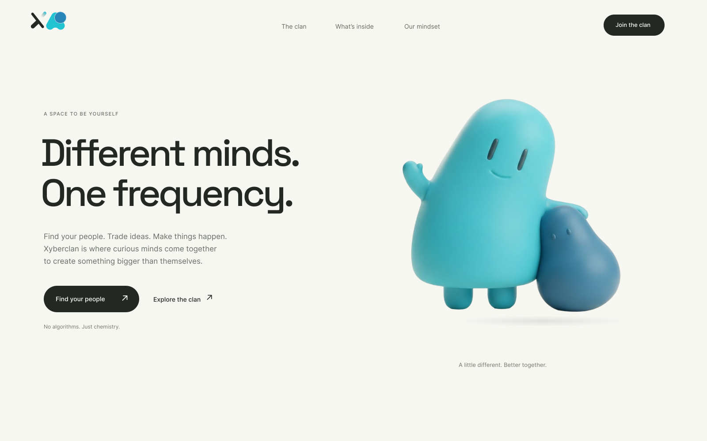

# XYB-031 — Hero: Different minds. One frequency.

## Why this exists (the strategy)
**Claim:** Xyberclan is a place where people who think differently find each other and make things together.

**Proof on the first screen:** the headline says it, the two blobs *show* it (two different characters, one
arm around the other), and the buttons let you act on it straight away.

The first screen decides if anyone scrolls. In five seconds a stranger must be able to say: "It's a
community, for curious people, and I can join." The two blobs are our strongest asset: they make people
smile before they read a word. This ticket turns the concept into a living, fast, accessible first screen.

## What the visitor should feel and do
- **Feel:** a smile, then "these are my kind of people".
- **Do:** press **Join the clan**, or **Meet the clan** to look around first.

## Scope
- The hero section of `/`: headline, supporting sentence, two buttons, microcopy, the 2D blob duo (inline SVG).
- The intro timeline (first load only) and the pointer/touch behaviour.
- The static first frame: the same inline SVG duo in its final pose (no JavaScript, reduced motion).

## Content

**Keep from the concept**
- Headline: **Different minds. One frequency.**
- The two blobs: the big **Lagoon** blob waving, arm around the small **Deep** blob. The concept's clay render is redrawn in 2D by XYB-016 (three flat tones, same silhouettes and faces).
- Paper ground, pill buttons, generous space.

**Supporting sentence** (draft — confirm in XYB-018):
> Find your people. Trade ideas. Make things happen. Xyberclan is where curious minds come together to make
> something bigger than themselves.

**Buttons**
- Primary: **Join the clan** → `/join` (ink pill).
- Secondary: **Meet the clan** → `/clan` (text link with → arrow).

**Microcopy** under the buttons: "No algorithms. Just chemistry."

**What changes from the concept, and why**

| Concept | Change | Why |
| --- | --- | --- |
| Eyebrow "A SPACE TO BE YOURSELF" | **Removed.** Its meaning goes into the supporting sentence if needed. | House rule: no small uppercase labels above headings. They read as template. |
| Headline about 6vw | **At least 7vw** (≈ 104px at 1440). | Big type is confidence. The headline is the hero's main shape next to the blobs. |
| Grey body text | **Full ink.** | Grey running text reads unfinished and fails contrast on paper. |
| "Find your people ↗" / "Explore the clan ↗" / "Join the clan" | **Join the clan** (primary) + **Meet the clan →** | One name per action across the site (creative direction §5). ↗ is only for links that leave the site. |
| Floating caption "A little different. Better together." | **Removed from the hero.** It becomes the blobs' accessible description, and can be reused in XYB-032. | A loose caption under the image reads as a stray label and splits attention. |
| Nav: The clan / What's inside / Our mindset | **+ Events**, and Join the clan as the nav action (XYB-030). | Events are a main reason people come. |

## Design spec

**Desktop (1440 × 900)**
- 12-column grid, outer margins from XYB-013. Hero height: 100svh minus the nav, minimum 760px.
- Text block: columns 1–6, vertically centred slightly above the middle (optical centre).
  - `h1` "Different minds. One frequency." at display size (≥ 7vw, clamp 56px → 128px), tracking -0.03em,
    leading 0.92, two lines exactly: line 1 "Different minds." line 2 "One frequency.".
  - Supporting sentence: 32–48px below the headline, text size large (20px), max 44ch, full ink.
  - Buttons: 40px below the sentence. Primary pill (height 56px) + secondary text link, 24px apart.
  - Microcopy: 16px below the buttons, 14px, ink at 70% (secondary note).
- Blob duo: columns 7–12, the big blob about 62% of the viewport height, feet sitting on an invisible floor
  at 82% of the hero height. Contact shadow under both (a flat ellipse layer in the art kit, not a CSS shadow). The duo may overlap the grid
  edge on the right by up to the outer margin, never past the screen.
- Nothing overlaps the headline.

**Tablet (768)**
- Text on top (full width), blob duo below, centred, about 48vh tall. Headline still two lines.

**Phone (390)**
- Order: headline (two lines, about 15vw ≈ 56px), sentence, buttons (primary full width, secondary below),
  microcopy, then the blob duo at 70% of screen width, peeking from the bottom of the first screen so people
  see there is more below.
- The primary button must be visible on the first screen without scrolling.

## Motion spec

**Intro (first visit, about 1.6s total; on later visits a 0.4s short version)**
1. 0.00s — headline words rise 24px + fade in, word by word, 70ms stagger (XYB-022). The headline is in the
   HTML and readable from the start; the animation only enhances it.
2. 0.25s — big Lagoon blob drops in from above the frame, lands with a **squash** (scaleY 0.82 / scaleX 1.12),
   bounces back with a little overshoot (XYB-026 `land`).
3. 0.70s — big blob **waves** (arm rotation, 2 cycles).
4. 0.90s — small Deep blob **peeks** out from behind the big one (slides 30% out, blinks), then settles under the arm.
5. 1.00s — sentence, buttons and microcopy fade + rise 16px, 80ms stagger.
6. After: both blobs idle on the **clan beat** (XYB-020): breathe, blink at slightly different moments, bob together.

Buttons are clickable from the very first frame. Nothing waits for the intro.

**Pointer**
- Both blobs' eyes and heads turn toward the pointer (XYB-026 `lookAt`), small range (max 12° head, eyes
  more), with smoothing. When the pointer leaves the window or the tab is hidden, they look back to the front.
- Hover the big blob: it leans slightly toward the pointer. Click/tap it: it **waves**. Click/tap the small
  one: it **blinks and wiggles** (shy). Max one reaction per 800ms.
- Keyboard: the blob duo is one focusable button "Say hi to the blobs" that triggers the wave.

**Touch:** no hover effects. Tap a blob to wave. Device tilt is not used.

**Scroll:** as the hero leaves, the duo moves slightly slower than the page (parallax 0.85) and hands over to
the signature scene (XYB-032), where the same two blobs are the first ones in the crowd.

**Reduced motion:** no intro, no lookAt, no parallax. Show the SVG duo in its final pose. Tapping still
gives a single-frame change (the arm switches to the raised pose) so the interaction is not lost.

## Build notes
- Files: `components/home/Hero.tsx`, `components/home/HeroBlobs.tsx`, `components/home/hero.timeline.ts`.
- **SVG first:** the duo is rendered on the server as inline SVG with `<Blob>` (XYB-025), using the hero art
  from XYB-016. It is in the first HTML, so there is no image request, no swap and no layout shift. Give the
  wrapper a fixed aspect ratio. The headline is the LCP element.
- The intro and pointer behaviours attach to the SVG groups (`arm-r`, `face`, `body`) after hydration. Before
  that, the duo already looks complete. On low-power devices (`navigator.hardwareConcurrency <= 4` or
  `saveData`), keep only the idle bob on the clan beat.
- The intro "first visit" flag lives in `sessionStorage` (wrapped in try/catch).
- Headline split with the accessible text reveal (XYB-022): the `h1` keeps its full text for screen readers.
- Blob behaviours (`land`, `wave`, `peek`, `lookAt`, `idle`) come from the blob kit (XYB-026); do not write new ones here.
- The duo SVG has `role="img"` and the label: "Two Xyberclan blobs: a big teal one waving with its arm around a small blue one."

## Acceptance criteria
- [ ] The `h1` reads "Different minds. One frequency." and is two lines at 1440, 768 and 390.
- [ ] No eyebrow label, no badge, no grey running text on the hero.
- [ ] Primary button "Join the clan" → `/join`; secondary "Meet the clan" → `/clan`; no ↗ arrows on internal links.
- [ ] Primary button is visible without scrolling on a 390 × 740 phone screen.
- [ ] LCP element is the headline, LCP < 2.0s on Lighthouse mobile (slow 4G throttling).
- [ ] With JavaScript off, the hero shows the full text, both buttons and the SVG duo in its final pose.
- [ ] Buttons work during the intro (click at 0.3s goes to the page).
- [ ] Blobs look at the pointer on desktop and return to the front when the pointer leaves the window.
- [ ] Tapping a blob on a phone makes it wave; the keyboard button "Say hi to the blobs" does the same.
- [ ] Reduced motion: no intro, no lookAt, no parallax; final pose shown at once.
- [ ] No layout shift when the blobs start animating (CLS < 0.02 for the hero).
- [ ] Blob animations pause when the hero is fully off screen or the tab is hidden.
- [ ] Bilingual: every visible string comes from `messages/*.json` or localized content (XYB-006); the section works in English and French, and every headline still fits two lines in French at 1440, 768 and 390.
- [ ] Follows the house rules in `docs/creative-direction.md` §4.

## Out of scope
- The crowd of member blobs (XYB-032). The blob artwork itself (XYB-016). Sound (XYB-028).

## References
- Duolingo: a mascot that reacts the moment you touch it.
- Character-led award sites (2D): eyes that follow the cursor, soft landings.
- Discord brand site: the character carries the first screen next to big, confident type.
